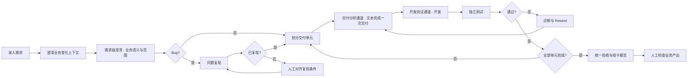

# LoopWork

LoopWork 是一个面向 **L4 Development** 的 AI 软件开发 Workflow Infra。它将工作重心从“人通过 Chat 持续推动 Agent”转为“确定性的 Harness 持续驱动多个专业 Agent”，使需求能够跨会话完成分析、开发、验证、恢复和结卡。

运行架构见 [DJI 架构](./docs/dji-architecture.md)，Workflow 设计见 [L4 LOOP 工作手册](./docs/l4-loop-handbook.md)。

## 核心原则

- **最小交付单元**：将长任务拆成决策明确、可以独立验证的业务切片，缩短无验证距离。
- **确定性外环，自主内环**：Harness 管理状态、权限、调度和恢复；Agent 处理分析、实现、验证和诊断。
- **人负责业务，系统负责工程**：人只提供目标、回答不可推导的业务歧义，并检查最终业务产出。
- **Claim、Evidence、Result 分离**：Agent 提交声明和证据，独立 Agent 做专业判断，Harness 只持久化结果并执行明确路由。
- **状态持久化**：规格、决策、Memory、执行结果和验证证据保存在对话之外，使任务可以继续、重试或 rewind。
- **职责独立**：交付分析 Agent、Dev、Test 和 Review Agent 分别处理规格、实现、验证和结卡。

## Development Loop

需求录入后，LoopWork 自动接管流程；除需求澄清、必要运行信息和最终验收外，不需要人逐步批准。



需求梳理 Agent 负责把原始输入转化为业务变化上下文：基于项目可用证据区分当前实际行为、当前应有业务语义和目标行为，明确三者之间的变化，并自主识别对业务结果有实质意义的影响。代码只是当前实现的一种证据，不等同于完整业务事实。Agent 只在业务目标、规则、参与者、范围、分类或验收结果无法推导时请求需求级澄清；识别影响不代表自动扩大范围。交付规划 Agent 冻结已经完成的业务变化上下文，把变化、保持约束、技术后果和需求级验收语义显式映射到有序的业务闭环；交付单元的参与者、触发条件、可观察结果、单元验收和自然依赖会作为正式契约传给交付分析 Agent，而不是只保留标题。

交付分析 Agent 把 Do It Twice 作为思考方法：在真实开发前基于冻结承诺和项目证据完整思考一次交付，主动发现需求文字之外的实际影响，并关闭会阻塞实现或验证的关键业务与核心技术决策。它不把推演过程做成表单，只持久化分析摘要、实际影响及处理方式、关键决策和冻结交付契约；已解决的技术决策无需虚构候选项，只有超出权限且会产生实质不同后果的最少决策才交给用户。Dev Agent 与 Test Agent 分别从同一份冻结契约出发：Dev 负责实现并提交验收证据关系和关键检查选择，Git、Commit、变更文件及 Runner 命令结果由 Application 自动取证；Test 不读取 Dev 的自述、自检、开发记录或 Commit message，而是先独立冻结测试计划，再逐项执行面向业务预期的黑盒验证。每项交付单元验收语义必须由真实前端覆盖完整用户闭环；API 场景可以补充边界、错误反馈和数据语义，也可以形成失败证据，但不能替代前端闭环。Review Agent 最后汇总实现与独立验证事实。

交付拆分后，同一需求进入双通道：交付分析通道串行分析后续单元，开发验证通道串行执行 `Dev(N) → Test(N)`，二者独立推进。这里的箭头只表示 Test 必须在 Dev 形成稳定仓库状态后执行，不表示 Dev Result 是 Test 输入；两者在认知上相互隔离，只共享交付分析冻结的契约。交付分析全局最多并发 4 个；当前共享工作区仍保持全局 1 个 Dev 和 1 个浏览器型 Agent。任一通道完成后立即重新调度，不等待其他通道或需求结束。

结卡前后的文档评论采用前向反馈流程：Feedback Agent 先把冻结批次按共同验收目标分组；直接回复和历史说明就地闭环，Bug 先复现；所有需要工程实施的 Bug、行为修订、范围新增和技术调整都先由交付规划 Agent 形成一个或多个完整的追加交付单元。旧交付单元、旧交付规格和旧文档始终作为历史事实保留，不因评论回退或改写；新增单元重新经过交付分析、开发、验证和 Feedback 独立验证，最后由 Review 生成反映最终状态的结卡报告。

## DJI 单工作目录

一个实例只运行一个工作目录，不支持项目注册、增删、切换或按项目筛选。默认使用启动目录，也可通过 `./start.sh --workspace /path/to/repository` 指定。工作目录在实例运行期间固定；环境变量 `LOOP_WORKSPACE_ROOT` 可在启动前显式指定，`.env` / `.env.local` 中的旧目录选择不再生效。

Agent 仍是原有 Workflow 中固定的角色；同名 `.omp/commands/*.md` 提供原生 Command Prompt，不会自动创建新角色、改变流程或增加节点。真正的 OMP 子 Agent 定义留在 `.omp/agents`。

状态数据库内部保留一个固定命名空间用于 Workflow 外键、锁和证据关联，不再构成多项目功能。已有任务的数据目录不能切换到其他工作目录；运行其他目录请使用独立 `--data-dir`。

## DJI 文件与 Agent 定义

原有 Workflow、角色分工、阶段流转及完整 Web UI 保留。系统按 OMP 原生规则扫描当前工作目录直属 `.omp/commands/*.md`，以文件名绑定固定角色，例如 `/backlog-agent`。frontmatter 的 name 若存在须与文件名一致；不扫描子目录或 `.omp/agents`，无效定义会明确报错。

主流程通过原生 slash command 展开检测到的 Markdown 正文，可引用 `.omp` Skill 和 Markdown 模板。新增、修改、删除文件会在下次页面加载或执行时直接反映，无需导入。缺失定义会在页面标明并阻止该角色执行，不回退到服务目录、环境配置或内部 Prompt。

LoopWork 内部只保留 Workflow 角色身份和执行协议，不向工作目录初始化或复制角色定义，也不编辑或演化覆盖 Agent Prompt。Prompt 页面用于展示检测结果、文件来源和正文。每次执行保留源文件审计快照，启动前核对源文件哈希和原生命令注册；流程协议作为工作包追加，专业正文不重复追加到 system prompt。Runtime 目录不再生成 `PROMPT.md` 副本；Agent frontmatter 可声明 `model`、`thinking`（兼容 `thinking-level` / `thinkingLevel`）、`tools` 和 `skills`；模型与思考强度仍可在每个 Agent 的 Runtime 页面自定义并优先于外部定义；留空字段继续继承外部定义、流程默认与 OMP 默认。`tools: []` 禁用内置工具，`skills` 对应 OMP 原生 Skill 名称过滤，Skill 的发现和加载由 OMP 自身完成。主流程角色使用一个模型，OMP 子 Agent 的专属配置仍由 OMP 管理。原角色 Prompt 文件位于本仓库 `.omp/commands/`，系统不会把它们自动复制到其他工作目录。

新版本默认使用 `data/dji/` 独立数据根目录，不导入之前运行的数据。文档、对话、日志、内容与 JSON 快照以独立文件保存，数据库保存状态、索引和文件引用；可在设置的“工作目录 → 文件存放目录”指定目录，也可用 `LOOP_FILES_ROOT` 固定目录。不同文档版本使用独立文件，事务回滚不覆盖已发布版本。 应同时备份完整数据根目录（包括状态数据库和 payload-key）及所选文件目录，切换存放目录不会搬迁旧文件。内容文件按哈希保存，未被提交或引用的文件可能作为孤立文件保留，当前不自动清理。

同名 Markdown 和 CJS 配对维护；每份 Prompt 明确对应脚本，每次工作包注入准确的角色、Pipeline、链 ID 和首个工具调用。脚本包含维护注释，详见 [命令脚本接口与维护指南](./docs/command-script-api.md)。

决策树按完整 JSON 文件保存：`<文件目录>/<taskId>/decisions/<kind>/<scopeId>/<hash>.json`。每份草稿和任务树集中保存节点、选项、依赖、推荐及答案；数据库仅保留节点身份、状态和文件引用。决策页面可查看、下载当前 JSON；修改仍经过原有命令与人工回答入口。每次修改保留独立文件，事务回滚不会覆盖旧版本。

## 人机边界

LoopWork 只在以下情况请求人介入：

1. 存在无法从代码、文档和已有事实推导的业务歧义。
2. 当前 Agent 缺少不可替代的非敏感运行信息。
3. Bug 在合理尝试后仍无法复现，需要对齐预期、入口、数据或环境。
4. 事件超出权限、风险或执行环境边界。
5. 所有交付单元完成后，需要检查最终业务产出。

人的回答会成为新的事实，而不是对 Plan 或代码的 Approval。普通实现失败和测试失败由系统自动诊断、重试或 rewind。

生产环境采用 Human Gate：Agent 可以只读分析线上日志、Trace、告警和指标，但所有线上结果必须通知人，生产发布、修复和回滚由人确认。

## Workflow Infra

不同工作目录的 Prompt 和业务知识不同，每个实例固定一个工作目录，底层 Workflow 保持一致。LoopWork 统一提供：

- Agent 调度、角色化上下文投影与认知隔离。
- execution 级 Context Snapshot、精简 Working Pack 和按需只读上下文检索。
- Workflow 状态机、任务队列和代码槽。
- 外部 Agent 输入快照、Memory、项目知识和交付规格。
- 结构化 Agent Result、Test Evidence 和 Trace。
- execution attempt、Receipt、中断恢复、重试和 rewind。
- Feedback Agent 的批次分组、前向追加工作和独立处理验证。
- 每个需求一个持久化 Chat 会话；Agent 每轮重新读取交付文档、活动和代码。Runner 空闲、相关文件归属清楚且调整不改变业务语义、范围、可观察结果或验收标准时，可直接完成局部 UI、排版和 wording 小改动，验证后只提交自己的代码且不创建交付单元；其他变化统一进入 Feedback 闭环，始终不由 Chat 修改 Loop 状态。
- 权限边界、人工介入和 OMP 执行驱动。
- 执行证据、Memory 与运行诊断界面保留；不生成内部 Prompt 候选，不自动改写外部 Agent。独立 Evaluator 默认停用，显式设置 `LOOP_ENABLE_EVALUATOR=1` 才会运行，其角色同样来自 `.omp/commands/evolution-evaluator.md`。

工作目录通过原生 Command、Skill 和 Markdown 模板维护专业指令、领域知识与规则；LoopWork 负责调度、状态和证据关系。

## 当前范围

| Profile | 状态 |
| --- | --- |
| L4 Development | 已运行主要闭环：需求规格 → 交付单元 → 开发 → 测试 → 结卡 |
| Human-gated L4 Delivery | 设计阶段：Agent 监测线上环境，生产操作由人确认 |
| L4 End-to-End | 设计阶段：客户需求 → BA → 工程交付 → 业务结果 |

当前实现采用 Next.js、SQLite 和本地 Runner。DJI 分支仅支持 Oh My Pi（OMP）CLI，但尚未证明大规模并发能力；Worktree 提供 Git 隔离，不等同于 OS 级安全沙箱。

## DJI 运行边界

- 原有 Workflow、角色权限、执行凭证、幂等、Dev / Test 隔离和结果应用仍由 LoopWork 管理。
- `.omp/commands` 维护原生 Command 专业指令，包括流程角色、任务 Chat、配置辅助和验证协助；Skill、规则及 Markdown 模板使用 OMP 自身的发现机制。
- 原生 `loopwork` 工具只暴露当前执行授权的领域命令，不执行 Shell。即使角色没有 Bash，也可查询状态、提交产物；服务端仍校验凭证与阶段。
- 命令链直接加载 `.omp/commands/<agent-id>.cjs` 原始源码。阶段描述、执行、校验、结果组装及恢复使用 API v1；共享实现也公开在 `.omp/commands/workflow/*.cjs`。页面可直接查看、修改、检查语法和保存源文件，保留阶段图与 Chat 辅助。详见 [命令脚本接口](./docs/command-script-api.md)。
- Web 日志通过运行事件推送，连接和丢失事件由定期校准恢复。任务执行、对话的模型事件继续呈现在原 UI。
- DJI 仅提供 Web 入口，不包含桌面端、历史数据库导入及其他执行器适配。

## 快速开始

DJI 分支保留完整 Workflow 和 Web UI，仅支持 OMP。`./start.sh` 启动 Web/API 和 Runner 监督服务；也可用 `./start.sh --port 8000 --data-dir /path/to/data` 指定端口和数据根目录。首次缺少依赖时自动安装。生产模式先 `npm run build`，再 `./start.sh --production`。

使用本地 Ollama 时，OMP 的上下文预算应与服务实际窗口一致。例如服务使用 65536 tokens，可用 `OLLAMA_CONTEXT_LENGTH=65536 ./start.sh --production` 启动。这是 [OMP 原生环境变量](https://github.com/can1357/oh-my-pi/blob/v17.2.15/docs/environment-variables.md)，只调整 OMP 的预算，不改变模型服务的运行窗口；LoopWork 直接继承，不维护另一套压缩逻辑。

要求 Node.js 20.9+ 环境，并预先安装并配置 Oh My Pi（OMP）CLI。LoopWork 通过本机 `omp --mode rpc` 驱动原生会话、工具、Skill 与上下文压缩。每次 Workflow 执行隔离会话，任务 Chat 使用可恢复会话，均保存在所选文件目录的 `sessions/` 下。模型和思考强度按字段继承：Agent 页面已启用配置中的自定义值 → 外部定义 → 流程全局默认 → OMP 默认。模型留空或思考强度选择默认时继续继承。专业 Prompt 始终来自外部文件。可通过 `OMP_CLI` 覆盖可执行文件路径。

```bash
npm install
./start.sh
```

打开 `http://localhost:3000`，确认页面显示的当前工作目录，再到 Agent 配置页为各流程 Agent 配置 OMP 模型和思考强度，然后在运行页面启动 Loop。目标工作目录需要准备对应 `.omp/commands/<agent-id>.md` 原生命令及 `.omp/commands/<agent-id>.cjs` 和对应共享实现源码；系统不会自动复制本仓库定义。

常用命令：

```bash
npm test
npm run build
npm run loopctl -- status
npm run loopctl -- paths
```

## 技术文档

- [DJI 架构](./docs/dji-architecture.md)：OMP、单工作目录、文件存储与运行边界。

- [L4 LOOP 工作手册](./docs/l4-loop-handbook.md)：WHY、设计原则、Development / Delivery / End-to-End 与统一 Infra。

## 目录

```text
app/                 Next.js 页面与 Server Actions
src/domain/          领域模型与协议
src/application/     Workflow 用例与状态推进
src/infrastructure/  数据库、Agent、验证与运行适配器
scripts/loop/         Runner、Agent 命令入口与 loopctl
migrations/          全局业务数据库迁移
docs/                工作手册与技术文档
```
